<div align="center">



<h1>Android System Control &amp; ENhanced Debloater</h1>

[](https://github.com/rootLocalGhost/A.S.C.E.N.D/releases)
[](https://github.com/rootLocalGhost/A.S.C.E.N.D/blob/main/LICENSE.md)

**A powerful, elegant desktop application built with Rust, Tauri v2, SolidJS, TypeScript, and Bun for taking complete control of your Android device.**

</div>

A.S.C.E.N.D. is a professional tool that wraps the power of ADB (Android Debug Bridge) and Scrcpy into a beautiful and intuitive graphical interface. Stop memorizing cryptic commands and start managing your device with the efficiency and style it deserves.

---

## ✨ Key Features

| Feature | Description |
| :------ | :---------- |
| **🚀 The Command Deck Debloater** | A completely reimagined debloating experience. Search 2,400+ known packages locally, see enabled/disabled/removed status at a glance, and batch disable, uninstall, or restore apps with a floating action bar. Includes curated recommendations, CSV export, and a searchable package database. |
| **📈 Live Dashboard** | A real-time overview of your device with model/Android info, battery, storage, CPU load, and RAM usage. Stats auto-refresh on a configurable interval and render sparkline history so you can spot changes instantly. |
| **🔌 Guided Connection Center** | Connect without memorizing ADB commands. The USB tab walks through enabling developer options, USB debugging, and authorization with live device detection. The wireless tab pairs Android 11+ devices with a pairing code, detects the device IP automatically, and connects or disconnects from any tab. |
| **🖥️ Seamless Scrcpy Integration** | Mirror and control your device with one click. Choose from Balanced, Performance, High Quality, or Recording presets, fine-tune every option, preview the generated command, and start/stop the mirror process with live status tracking. |
| **📂 Integrated File Explorer** | A full-featured file manager with `ls`-style details (size, permissions, dates), multi-select, sorting, path editing, batch download/upload/delete, rename, folder creation, and context-menu actions. |
| **⚡ Power User Toolkit** | Reboot to system, recovery, or bootloader; soft reboot; enable wireless ADB and pair Android 11+ devices; capture screenshots with an in-app preview; toggle GPU overdraw, layout bounds, and other developer overlays; and run arbitrary shell commands. |
| **🎮 Virtual Remote Control** | Control media, navigation, and volume from your keyboard. Includes a D-pad for TV boxes, dedicated media buttons, and a text injection field that safely escapes special characters. |
| **⌨️ Command Palette** | Press `Ctrl+K` to jump to any page or run common actions—refresh devices, take a screenshot, enable wireless ADB, restart the ADB server, clear logs, and more—without leaving the keyboard. |
| **🧰 Console & Preferences** | A collapsible live console (`Ctrl+Backtick`) shows every command and result. Settings let you pick a light, dark, or system theme, an accent colour, compact density, reduced motion, auto-refresh cadence, device monitoring, toast notifications, and destructive-action confirmations. |

### Bundled toolchain

ADB, Fastboot, and Scrcpy ship inside `bin/`. The app resolves them from the bundled resources, the application directory, or the project root in development, and Settings → Tools shows the exact detected path and version for each tool. If a custom location is needed, set `ASCEND_BIN_DIR` to the folder containing the executables.

---

## ⌨️ Keyboard Shortcuts

| Shortcut | Action |
| :------- | :----- |
| `Ctrl+K` | Open the command palette |
| `Ctrl+1` … `Ctrl+6` | Jump to Dashboard, Scrcpy, Debloater, Device, Files, or Remote |
| `Ctrl+Backtick` | Show/hide the console drawer |
| `F11` | Toggle fullscreen |
| `F5` | Refresh the current view (except Files) |
| `↑` `↓` `←` `→` / `Enter` / `Esc` | Remote D-pad navigation, select, and back |
| `+` / `-` / `M` | Remote volume up, volume down, mute |
| `Delete` | Delete selected files (Files tab) |
| `Ctrl+click` / `Shift+click` | Multi-select files (Files tab) |

> Remote keyboard shortcuts are active only on the Remote tab while the text field is not focused.

---

## 🛠️ Development & Building from Source

### Requirements

- [Rust](https://www.rust-lang.org/)
- [Bun](https://bun.sh/)

### Steps

```bash
# 1. Clone the repository
git clone https://github.com/rootLocalGhost/A.S.C.E.N.D.git

# 2. Navigate into the project directory
cd A.S.C.E.N.D

# 3. Install dependencies
bun install

# 4. Run the app in development mode
bun tauri dev

# 5. Build the distributable executable and installer
bun tauri build
```

---

## 📜 License & Disclaimer

This project is licensed under the **MIT License**. See the `LICENSE.md` file for details.

**Disclaimer:** This is a powerful tool. Deleting or disabling the wrong system packages can lead to device instability or bootloops. The user assumes all risk. When in doubt, do not remove a package without researching it first.
